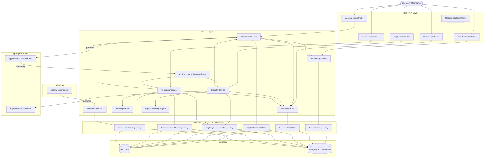
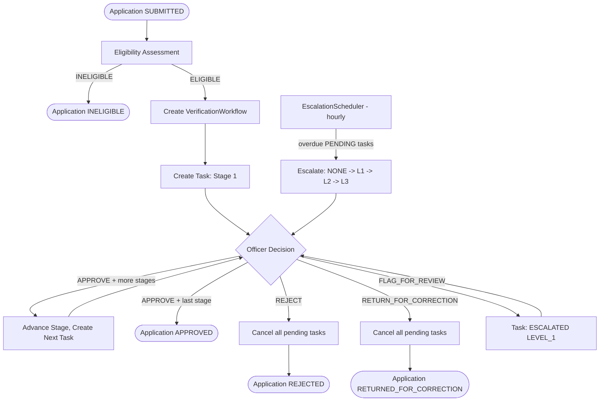
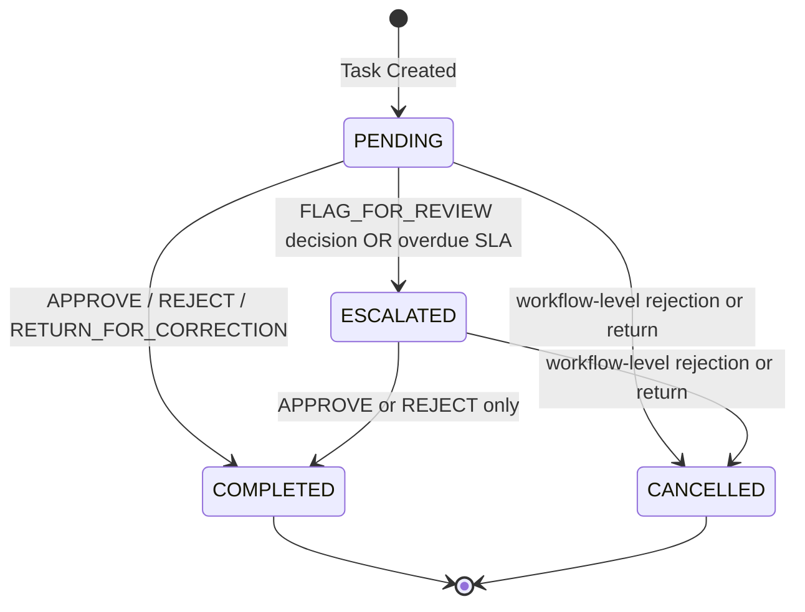

# SGDTS Milestone 2 — Technical Implementation Report

**Project:** Government Subsidy / Grant Disbursement Tracking System (SGDTS)
**Milestone:** 2 — Core Backend Modules
**Repository:** https://github.com/akshitap30/Government-Subsidy-Grant-Disbursement-Tracking-System_group1
**Report Date:** November 2026
**Classification:** Internal Technical Document

---

## Table of Contents

1. [Executive Summary](#1-executive-summary)
2. [Technology Stack](#2-technology-stack)
3. [System Architecture](#3-system-architecture)
4. [Module-wise Implementation](#4-module-wise-implementation)
5. [Business Logic](#5-business-logic)
6. [Eligibility Scoring Algorithm](#6-eligibility-scoring-algorithm)
7. [REST API Documentation](#7-rest-api-documentation)
8. [Verification Workflow](#8-verification-workflow)
9. [Testing and Results](#9-testing-and-results)
10. [Configuration and Environment](#10-configuration-and-environment)
11. [Exception Handling and Error Responses](#11-exception-handling-and-error-responses)
12. [Version Control and Commit History](#12-version-control-and-commit-history)
13. [Known Limitations and Future Scope](#13-known-limitations-and-future-scope)
14. [Appendix — Key Source File Index](#14-appendix--key-source-file-index)

---

## 1. Executive Summary

### 1.1 Project Overview

The Government Subsidy / Grant Disbursement Tracking System (SGDTS) is a production-grade Spring Boot application designed to digitise and automate the entire lifecycle of government grant disbursement in India. The platform manages beneficiary registration, grant scheme configuration, application intake, eligibility evaluation, and multi-level officer verification workflows.

### 1.2 Milestone 2 Objective

Milestone 2 delivers the complete backend for the core operational modules of SGDTS:

- **Beneficiary Management** — registration, profile management, and status tracking.
- **Scheme Master Data** — scheme lifecycle management with configurable eligibility criteria and routing rules.
- **Application Management** — draft creation, validation, submission, and status tracking with an immutable audit log.
- **Eligibility Assessment** — deterministic weighted scoring engine driven entirely by scheme-defined configuration.
- **Verification Workflow** — multi-level officer verification with score-and-amount-based routing, decision recording, separation-of-duties enforcement, and automatic task escalation.

### 1.3 Scope and Deliverables

| Deliverable | Status |
|---|---|
| Beneficiary CRUD with duplicate-email detection | ✅ Implemented |
| Scheme lifecycle (DRAFT → ACTIVE → INACTIVE) | ✅ Implemented |
| Configurable eligibility criteria per scheme | ✅ Implemented |
| Configurable routing rules per scheme | ✅ Implemented |
| Application draft and submission workflow | ✅ Implemented |
| Deterministic eligibility scoring engine | ✅ Implemented |
| Event-driven post-submission workflow automation | ✅ Implemented |
| Multi-level verification workflow | ✅ Implemented |
| Verification task escalation scheduler | ✅ Implemented |
| Unit tests for all core modules | ✅ Implemented |
| PostgreSQL persistence (production) | ✅ Configured |
| H2 in-memory persistence (testing) | ✅ Configured |
| Global exception handling | ✅ Implemented |
| Paginated REST APIs with consistent envelope | ✅ Implemented |
| OAuth2 / Spring Security placeholder | ✅ Configured (permit-all; full RBAC is future scope) |

---

## 2. Technology Stack

| Component | Technology | Version | Purpose |
|---|---|---|---|
| Language | Java | 21 (LTS) | Primary implementation language. Leverages records, sealed types, and switch expressions. |
| Framework | Spring Boot | 3.4.5 | Auto-configuration, dependency injection, embedded Tomcat server, and Spring ecosystem integration. |
| Build Tool | Apache Maven | 3.9.9 (wrapper) | Dependency management and reproducible project builds via `mvnw` / `mvnw.cmd`. |
| Persistence | Spring Data JPA / Hibernate | Spring Boot managed | ORM layer mapping Java entities to relational tables; supports JPQL and derived query methods. |
| Database (prod) | PostgreSQL | ≥ 14 (runtime) | ACID-compliant relational database for production. Configured via environment variables. |
| Database (test) | H2 (in-memory) | Spring Boot managed | No-install in-memory database for unit and integration tests; schema created by Hibernate (`create-drop`). |
| Schema Migration | Flyway | Spring Boot managed | Classpath-based SQL migration for production. Disabled by default; enabled when `SPRING_FLYWAY_ENABLED=true`. |
| Connection Pool | HikariCP | Spring Boot managed | High-performance JDBC connection pool; tuned for Supabase cloud connectivity. |
| Security | Spring Security + OAuth2 Client | Spring Boot managed | Security filter chain configured stateless with CSRF disabled. All `/api/**` endpoints are permit-all as a placeholder pending full RBAC integration. |
| Validation | Jakarta Bean Validation (Hibernate Validator) | Spring Boot managed | Declarative request body validation using `@NotNull`, `@NotBlank`, `@Valid` etc. |
| JSON | Jackson (spring-boot-starter-web) | Spring Boot managed | Serialisation/deserialisation of HTTP bodies and eligibility data stored as TEXT columns. |
| Code Generation | Lombok | Latest | Reduces boilerplate via `@Data`, `@Builder`, `@Slf4j`, `@RequiredArgsConstructor`. |
| Observability | Spring Boot Actuator | Spring Boot managed | Exposes `health`, `info`, and `metrics` endpoints for monitoring. |
| Notifications | Spring Mail | Spring Boot managed | Dependency included for future notification module; not functionally active in Milestone 2. |
| Developer Tools | Spring DevTools | Spring Boot managed | Automatic restart on class changes during local development. |
| Testing | JUnit 5 + Mockito + AssertJ | Spring Boot managed | Unit and slice tests. MockMvc for controller layer; Mockito for service layer with mocked repositories. |
| Testing Security | Spring Security Test | Spring Boot managed | Utilities for testing secured endpoints. |
| Cloud Database | Supabase (PostgreSQL) | Hosted | Production database provider; connection configured via pooler (port 6543) or direct (port 5432). |

---

## 3. System Architecture

### 3.1 Backend Architecture

The application uses a **modular monolith** pattern. All modules are deployed as a single Spring Boot application with strict internal boundaries enforced by package structure and dependency discipline. Inter-module communication uses:

- **Spring application events** for decoupled, asynchronous-compatible orchestration (e.g., `ApplicationSubmittedEvent`, `EligibilityAssessedEvent`).
- **Service-layer method calls** where direct coupling is intentional and explicitly justified.

### 3.2 Package Structure

```
com.sgdts.sgdts
├── SgdtsApplication.java               ← Entry point; enables scheduling
├── config/
│   ├── AppConfig.java                  ← Clock bean for testable time
│   └── SecurityConfig.java             ← Spring Security + CORS
├── common/
│   ├── ApiResponse.java                ← Standardised HTTP envelope
│   ├── PagedResponse.java              ← Pagination wrapper
│   ├── GlobalExceptionHandler.java     ← @RestControllerAdvice
│   ├── NotFoundException.java
│   ├── ConflictException.java
│   └── BusinessException.java
├── beneficiary/
│   ├── Beneficiary.java (entity)
│   ├── BeneficiaryRepository.java
│   ├── BeneficiaryService.java
│   ├── BeneficiaryController.java
│   ├── ProfileStatus.java (enum)
│   └── dto/  (RegisterBeneficiaryRequest, UpdateBeneficiaryRequest, BeneficiaryResponse)
├── scheme/
│   ├── Scheme.java (entity)
│   ├── EligibilityCriterion.java (entity)
│   ├── RoutingRule.java (entity)
│   ├── SchemeRepository.java
│   ├── SchemeService.java
│   ├── SchemeController.java
│   ├── SchemeStatus.java, CriterionType.java (enums)
│   └── dto/  (CreateSchemeRequest, UpdateSchemeRequest, SchemeResponse, CriterionDto, RoutingRuleDto, ActivateSchemeRequest)
├── application/
│   ├── GrantApplication.java (entity, table=grant_application)
│   ├── ApplicationRepository.java
│   ├── ApplicationService.java
│   ├── ApplicationController.java
│   ├── ApplicationWorkflowCoordinator.java (event listener)
│   ├── ApplicationSubmittedEvent.java (domain event)
│   ├── ApplicationStatus.java (enum)
│   └── dto/  (CreateApplicationRequest, UpdateApplicationRequest, ApplicationResponse)
├── eligibility/
│   ├── EligibilityAssessment.java (entity)
│   ├── EligibilityAssessmentRepository.java
│   ├── EligibilityScoringEngine.java (core scoring logic)
│   ├── EligibilityService.java
│   ├── EligibilityController.java
│   ├── AssessmentResult.java (record)
│   ├── CriterionResult.java (record)
│   ├── EligibilityOutcome.java (enum)
│   ├── EligibilityAssessedEvent.java (domain event)
│   └── dto/  (EligibilityAssessmentResponse)
└── verification/
    ├── VerificationWorkflow.java (entity)
    ├── VerificationTask.java (entity)
    ├── VerificationWorkflowRepository.java
    ├── VerificationTaskRepository.java
    ├── VerificationService.java
    ├── VerificationController.java
    ├── RoutingService.java
    ├── EscalationService.java
    ├── EscalationScheduler.java
    ├── VerificationStage.java, Decision.java, TaskStatus.java, EscalationLevel.java (enums)
    └── dto/  (CreateWorkflowRequest, WorkflowResponse, TaskResponse, RecordDecisionRequest)
```

### 3.3 Architecture Diagram



### 3.4 Controller–Service–Repository Responsibilities

| Layer | Responsibility |
|---|---|
| **Controller** | HTTP request/response mapping, path variable and query parameter extraction, calling the service, wrapping results in `ApiResponse`, returning appropriate HTTP status codes. Contains no business logic. |
| **Service** | Business rules, transaction boundaries (`@Transactional`), domain validation, state machine transitions, event publishing, coordination between modules. |
| **Repository** | Data access via Spring Data JPA; extends `JpaRepository`. Declares custom JPQL or derived-query finder methods. |
| **Entity** | JPA-mapped domain model; `@PrePersist`/`@PreUpdate` lifecycle hooks for timestamp management. |
| **DTO** | API contract; completely separated from entities to prevent internal detail leakage to consumers. |

---

## 4. Module-wise Implementation

### 4.1 Beneficiary Management

**Purpose:** Manages citizen profiles that act as the primary applicant identity for all grant applications.

**Key Classes:**

| Class | Role |
|---|---|
| `Beneficiary` | JPA entity; table `beneficiaries`; unique constraint on `email`. |
| `BeneficiaryService` | Register, fetch, list (paginated), and update operations. |
| `BeneficiaryController` | REST endpoints under `/api/v1/beneficiaries`. |
| `ProfileStatus` | Enum: `ACTIVE`, `SUSPENDED`. |

**Business Rules:**
- Email is normalised to lowercase and trimmed before persistence.
- Duplicate email registration throws `ConflictException` (HTTP 409).
- Profile updates are only permitted for `ACTIVE` beneficiaries; `SUSPENDED` profiles throw `BusinessException` (HTTP 422).
- Email cannot be updated after registration (the `update` endpoint supports: `fullName`, `phone`, `address`, `district`, `state`).

**Inputs:** `RegisterBeneficiaryRequest` (fullName, email, phone, address, district, state, dateOfBirth).
**Outputs:** `BeneficiaryResponse` (all fields plus `profileStatus`, `createdAt`, `updatedAt`).

---

### 4.2 Scheme Management

**Purpose:** Manages government grant schemes including their definition, eligibility criteria, routing rules, and lifecycle status.

**Key Classes:**

| Class | Role |
|---|---|
| `Scheme` | JPA entity; table `schemes`. Owns `EligibilityCriterion` and `RoutingRule` collections. |
| `EligibilityCriterion` | Child entity; table `eligibility_criteria`. Linked to a scheme via `@ManyToOne`. |
| `RoutingRule` | Child entity. Specifies score/amount bands and their ordered verification stages. |
| `SchemeService` | Full lifecycle management with pre-activation validation. |
| `SchemeController` | REST endpoints under `/api/v1/schemes`. |
| `SchemeStatus` | Enum: `DRAFT`, `ACTIVE`, `INACTIVE`. |
| `CriterionType` | Enum: `NUMERIC_MIN`, `NUMERIC_MAX`, `EQUALS`, `NOT_EQUALS`, `BOOLEAN`, `ENUM_MATCH`, `REQUIRED`. |

**Business Rules:**
- Schemes are created in `DRAFT` status.
- Criteria and routing rules can only be modified while in `DRAFT`.
- Activation (`POST /activate`) validates:
  - `minGrantAmount` ≤ `maxGrantAmount`.
  - All criteria have non-blank `criterionId` values with no duplicates.
  - Total criteria weight > 0.
  - At least one routing rule exists.
  - Each routing rule has valid `minScore`, `maxScore` within [0, 100], valid grant amount range, and at least one stage name that maps to a known `VerificationStage` enum value.
- Scheme has an internal `configVersion` counter incremented on every `@PreUpdate` event. This version is snapshotted into each application at submit time for audit accuracy.

---

### 4.3 Application Management

**Purpose:** Manages the lifecycle of a beneficiary's grant application from initial draft creation through to a terminal decision.

**Key Classes:**

| Class | Role |
|---|---|
| `GrantApplication` | JPA entity; table `grant_application` (name avoids SQL reserved word `APPLICATION`). Has `@Version` for optimistic locking. |
| `ApplicationService` | Draft creation, validation, submission, cancellation, and state-update helpers for other modules. |
| `ApplicationController` | REST endpoints under `/api/v1/applications`. |
| `ApplicationStatus` | Enum: `DRAFT`, `SUBMITTED`, `ELIGIBILITY_REVIEW`, `UNDER_VERIFICATION`, `RETURNED_FOR_CORRECTION`, `APPROVED`, `REJECTED`, `INELIGIBLE`, `CANCELLED`. |
| `ApplicationSubmittedEvent` | Spring record event published on successful submission. |
| `ApplicationWorkflowCoordinator` | `@EventListener` that triggers eligibility assessment and optionally creates a verification workflow upon application submission. |

**Key Fields on `GrantApplication`:**
- `referenceNumber` — human-readable unique reference (`APP-{System.currentTimeMillis()}`).
- `eligibilityData` — applicant answers serialised as a JSON `TEXT` column (`Map<String, String>`).
- `schemeConfigVersion` — snapshot of `Scheme.configVersion` at submission time.
- `statusHistory` — `@ElementCollection` list storing `"STATUS:ISO-timestamp"` entries for lightweight audit trail (table: `application_status_history`).

**Business Rules:**
- Beneficiary must exist. Scheme must exist at draft creation (but need not be active yet).
- At submission, the scheme must be `ACTIVE`.
- Requested amount must be within the scheme's `[minGrantAmount, maxGrantAmount]` range.
- If a beneficiary already has an active application (`SUBMITTED`, `ELIGIBILITY_REVIEW`, `UNDER_VERIFICATION`) for the same scheme, re-submission throws `ConflictException`.
- Idempotent submit: re-submitting an already-submitted application returns the existing record without error.
- Cancel is blocked for terminal statuses: `APPROVED`, `REJECTED`, `CANCELLED`.

---

### 4.4 Eligibility Assessment and Scoring

**Purpose:** Evaluates a submitted application against the scheme's eligibility criteria using a configurable weighted scoring engine.

**Key Classes:**

| Class | Role |
|---|---|
| `EligibilityScoringEngine` | Core stateless scoring engine; no persistence dependency. |
| `EligibilityService` | Orchestrates assessment: loads application/scheme, calls engine, persists result, updates application status, publishes event. |
| `EligibilityAssessment` | JPA entity; table `eligibility_assessments`. |
| `AssessmentResult` | Java record capturing the full output of one engine evaluation. |
| `CriterionResult` | Java record capturing per-criterion pass/fail, earned score, max score, and reason string. |
| `EligibilityOutcome` | Enum: `ELIGIBLE`, `INELIGIBLE`. |
| `EligibilityController` | REST endpoints under `/api/v1/applications/{id}/eligibility-assessment`. |

**Business Rules:**
- Assessment can only be performed on `SUBMITTED` applications.
- Re-assessment is blocked (idempotency); a `ConflictException` is thrown if an assessment already exists.
- After assessment, the application status transitions to `ELIGIBILITY_REVIEW` (ELIGIBLE) or `INELIGIBLE`.
- Assessment details (all criterion results) are serialised as JSON and stored in `assessmentDetails TEXT` for full auditability.
- An `EligibilityAssessedEvent` is published post-persistence.

---

### 4.5 Verification Workflow

**Purpose:** Routes eligible applications through one or more ordered verification stages performed by officers, culminating in a final approval, rejection, or return-for-correction decision.

**Key Classes:**

| Class | Role |
|---|---|
| `VerificationWorkflow` | JPA entity; table `verification_workflows`. Tracks ordered stage list and current stage index. Has `@Version` for optimistic locking. |
| `VerificationTask` | JPA entity; table `verification_tasks`. One task per active stage. Has `@Version` for optimistic locking. |
| `VerificationService` | Workflow creation, task management, decision recording, and stage advancement. |
| `RoutingService` | Stateless service that selects the matching routing rule and returns the ordered stage list. |
| `EscalationService` | Escalates overdue `PENDING` tasks up to `LEVEL_3`. Clock-injectable for testability. |
| `EscalationScheduler` | `@Scheduled` trigger that calls `EscalationService` hourly. |
| `VerificationController` | REST endpoints for workflow creation and task management. |
| `VerificationStage` | Enum: `INITIAL_REVIEW`, `FIELD_VERIFICATION`, `DISTRICT_REVIEW`, `SENIOR_APPROVAL`, `FINANCE_REVIEW`. |
| `Decision` | Enum: `APPROVE`, `REJECT`, `RETURN_FOR_CORRECTION`, `FLAG_FOR_REVIEW`. |
| `TaskStatus` | Enum: `PENDING`, `ESCALATED`, `COMPLETED`, `CANCELLED`. |
| `EscalationLevel` | Enum: `NONE`, `LEVEL_1`, `LEVEL_2`, `LEVEL_3`. |

---

### 4.6 Escalation

**Purpose:** Automatically escalates verification tasks that remain unresolved beyond their SLA deadline.

**Implementation:**
- Each task is assigned a `dueAt` = `LocalDateTime.now() + 72 hours` at creation.
- `EscalationScheduler` fires every hour (configurable via `sgdts.escalation.interval-ms`; default 3,600,000 ms).
- `EscalationService.escalateOverdueTasks(LocalDateTime asOf)` queries all `PENDING` tasks with `dueAt < asOf`.
- Tasks are escalated one level per run: `NONE → LEVEL_1 → LEVEL_2 → LEVEL_3`.
- Tasks at `LEVEL_3` are not escalated further.
- Terminal tasks (`COMPLETED`, `CANCELLED`) are skipped.
- Each escalation appends a timestamped entry to the task's `escalationHistory` `@ElementCollection` list.
- An officer's `FLAG_FOR_REVIEW` decision also triggers escalation to `LEVEL_1` immediately.

---

## 5. Business Logic

### 5.1 Complete Application Lifecycle

```
DRAFT ---(submit)---> SUBMITTED
                           |
                    (auto: eligibility assessment)
                           |
              ELIGIBILITY_REVIEW <--- ELIGIBLE
                           |
                    (auto: workflow creation)
                           |
                  UNDER_VERIFICATION
                           |
                    Officer Decision
                   /        |         \
              APPROVE     REJECT    RETURN_FOR_CORRECTION
              (advance     |            |
              or final)    v            v
              APPROVED   REJECTED  RETURNED_FOR_CORRECTION

              INELIGIBLE <--- INELIGIBLE outcome
              CANCELLED <--- (manual cancel at any non-terminal stage)
```

### 5.2 Beneficiary Validation

On registration:
1. Email is normalised (trimmed, lower-cased).
2. Repository is queried for an existing beneficiary with the same email.
3. If found → `ConflictException`.
4. All mandatory fields (fullName, email, phone, address, district, state, dateOfBirth) are validated by Bean Validation annotations on `RegisterBeneficiaryRequest`.

### 5.3 Scheme Activation and Eligibility Criteria

A scheme can only be activated from `DRAFT` or `INACTIVE` status. Pre-activation validation (in `SchemeService.validateSchemeForActivation`):
1. Grant amount limits are non-negative and min ≤ max.
2. Each criterion has a non-blank, unique `criterionId`.
3. Sum of all criteria weights > 0.
4. At least one routing rule is configured.
5. Every routing rule has: valid score range [0, 100], valid grant amount range, at least one valid `VerificationStage` name.

### 5.4 Application Submission

1. Beneficiary existence is verified.
2. The scheme is fetched and confirmed `ACTIVE`.
3. `requestedAmount` is validated within `[scheme.minGrantAmount, scheme.maxGrantAmount]`.
4. Active duplicate check: no existing application in `SUBMITTED`, `ELIGIBILITY_REVIEW`, or `UNDER_VERIFICATION` for the same beneficiary–scheme pair.
5. `schemeConfigVersion` is snapshotted from `scheme.configVersion`.
6. Status transitions to `SUBMITTED`; `submittedAt` is set.
7. `ApplicationSubmittedEvent` is published.

### 5.5 Eligibility Evaluation (Auto-triggered by Event)

After `ApplicationSubmittedEvent`:
1. `ApplicationWorkflowCoordinator` calls `EligibilityService.assessApplication(applicationId)`.
2. `EligibilityService` loads the application, verifies status is `SUBMITTED`.
3. The scheme's criteria are loaded. The application's `eligibilityData` JSON is deserialised to `Map<String, String>`.
4. `EligibilityScoringEngine.evaluate(criteria, input, schemeConfigVersion)` is called.
5. The result is persisted as an `EligibilityAssessment`.
6. The application status is updated to `ELIGIBILITY_REVIEW` (ELIGIBLE) or `INELIGIBLE`.
7. If ELIGIBLE, the coordinator immediately calls `VerificationService.createWorkflow(applicationId)`.

### 5.6 Verification Routing Selection

`RoutingService.determineStages(rules, normalizedScore, requestedAmount)`:
1. Iterates routing rules in the scheme's configured order.
2. For each rule, checks: `rule.minScore ≤ score ≤ rule.maxScore` AND `amount ≥ rule.minGrantAmount` AND (`rule.maxGrantAmount == null` OR `amount ≤ rule.maxGrantAmount`).
3. Returns `List.copyOf(rule.getStages())` for the **first** matching rule.
4. If no rule matches → `BusinessException` (HTTP 422).

### 5.7 Approval, Rejection, and Return-for-Correction

Decision recording in `VerificationService.recordDecision(taskId, request)`:

| Decision | Behaviour |
|---|---|
| `APPROVE` | Task → `COMPLETED`. If more stages remain, workflow advances, next stage task is created, application stays `UNDER_VERIFICATION`. If this is the final stage, workflow and application → `APPROVED`. |
| `REJECT` | All remaining pending tasks → `CANCELLED`. Workflow → `COMPLETED` with `finalDecision=REJECT`. Application → `REJECTED`. |
| `RETURN_FOR_CORRECTION` | All remaining tasks → `CANCELLED`. Workflow → `COMPLETED` with `finalDecision=RETURN_FOR_CORRECTION`. Application → `RETURNED_FOR_CORRECTION`. |
| `FLAG_FOR_REVIEW` | Task → `ESCALATED`, escalation level set to `LEVEL_1` (if currently `NONE`). Escalation history entry appended. |

### 5.8 Escalation and Task Deadlines

- Default SLA: **72 hours** from task creation (`VerificationService.TASK_DUE_HOURS = 72L`).
- Scheduler interval: **1 hour** (configurable via `sgdts.escalation.interval-ms`).
- Maximum escalation level: **LEVEL_3**; tasks at `LEVEL_3` are not escalated again.
- Separation of duties: an officer who has already `APPROVE`d a task in an earlier stage of the same workflow cannot approve a subsequent stage.

---

## 6. Eligibility Scoring Algorithm

### 6.1 Algorithm Overview

The `EligibilityScoringEngine` implements a **deterministic weighted additive scoring** model. All weights and expected values are defined in the scheme configuration — the engine contains no hardcoded domain-specific defaults.

### 6.2 Score Range

| Metric | Range |
|---|---|
| `normalizedScore` | 0.00 to 100.00 (2 decimal places) |
| `totalScore` | 0 to sum of all criteria weights |
| `maxPossibleScore` | Sum of all criteria weights |

### 6.3 Scoring Formula

```
totalScore        = sum of weight(criterion_i) for all criterion_i where passed == true
maxPossibleScore  = sum of weight(criterion_i) for all criterion_i (regardless of pass/fail)

normalizedScore   = (totalScore / maxPossibleScore) x 100
                    intermediate: scale=4, RoundingMode.HALF_UP
                    final output: scale=2, RoundingMode.HALF_UP

Special case: if maxPossibleScore == 0 then normalizedScore = 0
```

**Source reference:** `EligibilityScoringEngine.computeNormalizedScore()` lines 178–185.

### 6.4 Criterion Types and Evaluation Logic

| CriterionType | Pass Condition |
|---|---|
| `NUMERIC_MIN` | `actual >= threshold` (both parsed as `BigDecimal`). Non-numeric input → fail. |
| `NUMERIC_MAX` | `actual <= threshold`. Non-numeric input → fail. |
| `EQUALS` | `actual.trim().equalsIgnoreCase(expected.trim())`. |
| `NOT_EQUALS` | `!actual.trim().equalsIgnoreCase(expected.trim())`. |
| `BOOLEAN` | `Boolean.parseBoolean(actual) == Boolean.parseBoolean(expected)`. |
| `ENUM_MATCH` | `actual.trim()` case-insensitively matches any value in the comma-separated `expectedValue` string. |
| `REQUIRED` | Input is present and non-blank (always passes if the value is provided). |

### 6.5 Mandatory Criteria Behaviour

- Any criterion can be marked `mandatory = true`.
- If a mandatory criterion **fails** (any type, including bad parse or missing input), it is added to `failedMandatory`.
- If `failedMandatory` is **non-empty** at the end of evaluation → `EligibilityOutcome.INELIGIBLE`, regardless of `normalizedScore`.
- The `normalizedScore` is still computed and stored even when outcome is `INELIGIBLE`.
- Missing input for a **mandatory** criterion → failure with reason "Required value missing for criterion: `<id>`".
- Missing input for an **optional** criterion → skipped (not a failure).

### 6.6 Configurable vs Hardcoded Values

| Item | Type |
|---|---|
| Criterion weights | Configurable per scheme |
| Expected values (thresholds, enums, booleans) | Configurable per scheme |
| Mandatory flag per criterion | Configurable per scheme |
| Score scale (4 for intermediate, 2 for final output) | **Hardcoded** in `EligibilityScoringEngine` |
| Rounding mode (`HALF_UP`) | **Hardcoded** in `EligibilityScoringEngine` |
| Score range (0–100) | **Hardcoded** (by normalisation formula) |
| Task SLA (72 hours) | **Hardcoded** in `VerificationService.TASK_DUE_HOURS` |
| Escalation interval (1 hour default) | Configurable via `sgdts.escalation.interval-ms` |

### 6.7 Worked Numerical Example

**Scheme Criteria for "PM Kisan Scheme (Demo)":**

| criterionId | Type | Expected | Weight | Mandatory |
|---|---|---|---|---|
| `annual_income` | `NUMERIC_MAX` | `300000` | 50.0 | Yes |
| `land_size_acres` | `NUMERIC_MIN` | `2.0` | 50.0 | No |

**Applicant Input:**
```
annual_income   = "250000"
land_size_acres = "3.5"
```

**Step-by-step Evaluation:**

1. **annual_income** (`NUMERIC_MAX`, threshold = 300,000):
   - actual = 250,000; 250,000 ≤ 300,000 → **PASSED**
   - earnedScore = 50.0

2. **land_size_acres** (`NUMERIC_MIN`, threshold = 2.0):
   - actual = 3.5; 3.5 ≥ 2.0 → **PASSED**
   - earnedScore = 50.0

**Totals:**
```
totalScore       = 50.0 + 50.0 = 100.0
maxPossibleScore = 50.0 + 50.0 = 100.0
normalizedScore  = (100.0 / 100.0) x 100 = 100.00
failedMandatory  = []
outcome          = ELIGIBLE
```

**Scenario with mandatory failure (income exceeds limit):**

Applicant Input: `annual_income = "450000"`, `land_size_acres = "3.5"`

```
annual_income: 450,000 > 300,000 → FAILED (mandatory)
land_size_acres: 3.5 >= 2.0 → PASSED, earnedScore = 50.0

totalScore       = 50.0
maxPossibleScore = 100.0
normalizedScore  = (50.0 / 100.0) x 100 = 50.00
failedMandatory  = ["annual_income"]
outcome          = INELIGIBLE (overrides score despite 50.00)
```

*(This exact scenario is verified in `EligibilityScoringEngineTest.testMandatoryConditionFailure()`)*

### 6.8 Score-to-Routing Mapping

After `normalizedScore` is computed, `RoutingService` selects the verification path:

**Example routing rules (from `RoutingServiceTest` configuration):**

| Score Range | Grant Amount Range | Verification Stages |
|---|---|---|
| 80.00 – 100.00 | 1,000 – 50,000 | `INITIAL_REVIEW` |
| 50.00 – 79.99 | 1,000 – 50,000 | `INITIAL_REVIEW` → `FIELD_VERIFICATION` |
| 50.00 – 100.00 | 50,000.01 – 1,000,000 | `INITIAL_REVIEW` → `DISTRICT_REVIEW` → `SENIOR_APPROVAL` → `FINANCE_REVIEW` |

---

## 7. REST API Documentation

All endpoints return responses wrapped in the standard `ApiResponse<T>` envelope:
```json
{
  "success": true,
  "message": "optional message",
  "data": { ... },
  "errors": null
}
```

### 7.1 Beneficiary Endpoints

| Method | Endpoint | Purpose | Request Body | Response | Status Codes |
|---|---|---|---|---|---|
| `POST` | `/api/v1/beneficiaries` | Register a new beneficiary | `RegisterBeneficiaryRequest` | `BeneficiaryResponse` | 201, 409, 400 |
| `GET` | `/api/v1/beneficiaries/{id}` | Fetch beneficiary by UUID | — | `BeneficiaryResponse` | 200, 404 |
| `GET` | `/api/v1/beneficiaries/{id}/exists` | Check if beneficiary exists | — | `Boolean` | 200 |
| `GET` | `/api/v1/beneficiaries?page=0&size=20` | List all beneficiaries (paginated) | — | `PagedResponse<BeneficiaryResponse>` | 200 |
| `PUT` | `/api/v1/beneficiaries/{id}` | Update allowed profile fields | `UpdateBeneficiaryRequest` | `BeneficiaryResponse` | 200, 404, 422 |

### 7.2 Scheme Endpoints

| Method | Endpoint | Purpose | Request Body | Response | Status Codes |
|---|---|---|---|---|---|
| `POST` | `/api/v1/schemes` | Create a new scheme (DRAFT) | `CreateSchemeRequest` | `SchemeResponse` | 201, 400 |
| `GET` | `/api/v1/schemes/{id}` | Fetch scheme by UUID | — | `SchemeResponse` | 200, 404 |
| `GET` | `/api/v1/schemes?status=ACTIVE&page=0&size=20` | List schemes (optional status filter, sorted by createdAt desc) | — | `PagedResponse<SchemeResponse>` | 200 |
| `PUT` | `/api/v1/schemes/{id}` | Update a DRAFT scheme | `UpdateSchemeRequest` | `SchemeResponse` | 200, 404, 422 |
| `GET` | `/api/v1/schemes/{id}/criteria` | Get all criteria for a scheme | — | `List<CriterionDto>` | 200, 404 |
| `PUT` | `/api/v1/schemes/{id}/criteria` | Replace criteria list (DRAFT only) | `List<CriterionDto>` | `SchemeResponse` | 200, 422 |
| `GET` | `/api/v1/schemes/{id}/routing-rules` | Get routing rules for a scheme | — | `List<RoutingRuleDto>` | 200, 404 |
| `PUT` | `/api/v1/schemes/{id}/routing-rules` | Replace routing rules (DRAFT only) | `List<RoutingRuleDto>` | `SchemeResponse` | 200, 422 |
| `POST` | `/api/v1/schemes/{id}/activate` | Activate a DRAFT or INACTIVE scheme | Optional `ActivateSchemeRequest` | `SchemeResponse` | 200, 422 |
| `POST` | `/api/v1/schemes/{id}/deactivate` | Deactivate an ACTIVE scheme | — | `SchemeResponse` | 200, 422 |

### 7.3 Application Endpoints

| Method | Endpoint | Purpose | Request Body | Response | Status Codes |
|---|---|---|---|---|---|
| `POST` | `/api/v1/applications` | Create a draft application | `CreateApplicationRequest` | `ApplicationResponse` | 201, 400, 404 |
| `GET` | `/api/v1/applications/{id}` | Fetch application by UUID | — | `ApplicationResponse` | 200, 404 |
| `GET` | `/api/v1/applications/{id}/status` | Fetch application status | — | `ApplicationResponse` | 200, 404 |
| `GET` | `/api/v1/applications?beneficiaryId=&schemeId=&status=&page=0&size=20` | List applications with optional filters | — | `PagedResponse<ApplicationResponse>` | 200 |
| `PUT` | `/api/v1/applications/{id}` | Update a DRAFT application | `UpdateApplicationRequest` | `ApplicationResponse` | 200, 422 |
| `POST` | `/api/v1/applications/{id}/submit` | Submit a DRAFT application | — | `ApplicationResponse` | 200, 404, 409, 422 |
| `POST` | `/api/v1/applications/{id}/cancel` | Cancel a non-terminal application | — | `ApplicationResponse` | 200, 404, 422 |

### 7.4 Eligibility Assessment Endpoints

| Method | Endpoint | Purpose | Request Body | Response | Status Codes |
|---|---|---|---|---|---|
| `POST` | `/api/v1/applications/{id}/eligibility-assessment` | Trigger eligibility assessment (manual fallback) | — | `EligibilityAssessmentResponse` | 201, 409, 422 |
| `GET` | `/api/v1/applications/{id}/eligibility-assessment` | Retrieve existing assessment result | — | `EligibilityAssessmentResponse` | 200, 404 |

### 7.5 Verification Endpoints

| Method | Endpoint | Purpose | Request Body / Params | Response | Status Codes |
|---|---|---|---|---|---|
| `POST` | `/api/v1/verification/workflows` | Create verification workflow (manual fallback) | `CreateWorkflowRequest` | `WorkflowResponse` | 201, 422 |
| `GET` | `/api/v1/applications/{id}/workflow` | Fetch workflow and task history | — | `WorkflowResponse` | 200, 404 |
| `GET` | `/api/v1/verification/tasks?officerId=&page=0&size=20` | List pending tasks for an officer | Query param `officerId` | `PagedResponse<TaskResponse>` | 200 |
| `POST` | `/api/v1/verification/tasks/{taskId}/decisions` | Record a verification decision | `RecordDecisionRequest` | `TaskResponse` | 200, 404, 409, 422 |
| `POST` | `/api/v1/verification/tasks/{taskId}/reassign?officerId=` | Reassign a task to another officer | Query param `officerId` | `TaskResponse` | 200, 404, 422 |

---

## 8. Verification Workflow

### 8.1 Workflow Stages

The ordered stage names are determined at workflow creation time by `RoutingService` and stored in `VerificationWorkflow.stages` as a `List<String>`. The `currentStageIndex` integer advances on each approval.

Supported stage names (from `VerificationStage` enum):

| Stage | Purpose |
|---|---|
| `INITIAL_REVIEW` | First-line document and data review by a junior officer |
| `FIELD_VERIFICATION` | On-site verification for moderate-score or borderline cases |
| `DISTRICT_REVIEW` | District-level administrative review for large-grant applications |
| `SENIOR_APPROVAL` | Senior officer sign-off for high-value applications |
| `FINANCE_REVIEW` | Finance department clearance before disbursement |

### 8.2 Score- and Amount-Based Routing

Routing is determined by `RoutingService.determineStages()` which evaluates rules in configured order:

- **Score match:** `rule.minScore <= normalizedScore <= rule.maxScore`
- **Amount match:** `requestedAmount >= rule.minGrantAmount` AND (`rule.maxGrantAmount == null` OR `requestedAmount <= rule.maxGrantAmount`)
- First matching rule wins and its `stages` list is returned.

### 8.3 Workflow State Diagram



### 8.4 Task State Diagram



### 8.5 Separation of Duties

Enforced in `VerificationService.recordDecision()`:
- If `actorId` is provided and the task has an assigned officer, the actor must match.
- An actor who has already recorded `APPROVE` on any earlier task in the **same workflow** is blocked from approving subsequent stages.
- A `BusinessException` (HTTP 422) is thrown on violation.

---

## 9. Testing and Results

### 9.1 Test Technology

- **JUnit 5** — test framework with `@Test`, `@BeforeEach`, `@DisplayName`.
- **Mockito** (`@Mock`, `@InjectMocks`, `@ExtendWith(MockitoExtension.class)`) — service layer tests with mocked repositories.
- **AssertJ** — fluent assertion library (`assertThat`, `assertThatThrownBy`).
- **Spring MockMvc** — controller-layer slice tests.
- **H2 in-memory** — integration test persistence without requiring PostgreSQL.

### 9.2 Test Classes

| Test Class | Module | Type |
|---|---|---|
| `BeneficiaryServiceTest` | Beneficiary | Unit (Mockito) |
| `BeneficiaryControllerTest` | Beneficiary | MockMvc slice |
| `SchemeServiceTest` | Scheme | Unit (Mockito) |
| `SchemeControllerTest` | Scheme | MockMvc slice |
| `ApplicationServiceTest` | Application | Unit (Mockito) |
| `ApplicationControllerTest` | Application | MockMvc slice |
| `ApplicationWorkflowIntegrationTest` | Application + Eligibility + Verification | Integration |
| `EligibilityScoringEngineTest` | Eligibility | Unit (pure Java, no Spring) |
| `EligibilityServiceTest` | Eligibility | Unit (Mockito) |
| `EligibilityControllerTest` | Eligibility | MockMvc slice |
| `VerificationServiceTest` | Verification | Unit (Mockito) |
| `VerificationControllerTest` | Verification | MockMvc slice |
| `RoutingServiceTest` | Verification | Unit (pure Java, no Spring) |
| `EscalationServiceTest` | Verification | Unit (Mockito) |
| `SgdtsApplicationTests` | Root | Spring context load |

### 9.3 Documented Test Cases — `EligibilityScoringEngineTest`

| # | Test Name | Description | Expected Outcome |
|---|---|---|---|
| 1 | `testAllCriteriaPass` | All criteria pass with full score | ELIGIBLE, normalizedScore = 100.00 |
| 2 | `testMandatoryConditionFailure` | Mandatory criterion fails despite high optional score | INELIGIBLE, failedMandatory populated |
| 3 | `testMissingMandatoryInput` | No value provided for mandatory REQUIRED criterion | INELIGIBLE |
| 4 | `testMissingOptionalInput` | Optional criterion skipped, mandatory passes | ELIGIBLE, partial score = 50.00 |
| 5 | `testInvalidNumericInput` | Non-numeric string for NUMERIC_MIN mandatory criterion | INELIGIBLE; reason contains "Non-numeric value" |
| 6 | `testNotEqualsCriterion` | NOT_EQUALS passes when value differs | ELIGIBLE for NON_PAYER; INELIGIBLE for INCOME_TAX_PAYER |
| 7 | `testEnumMatchCriterion` | ENUM_MATCH validates against comma-separated accepted set | ELIGIBLE for MARGINAL_FARMER; INELIGIBLE for LARGE_COMMERCIAL |
| 8 | `testBooleanCriterion` | BOOLEAN matches true/false condition | ELIGIBLE for "true"; INELIGIBLE for "false" |
| 9 | `testZeroWeightCriterion` | Zero-weight mandatory criterion acts as a gate without score contribution | ELIGIBLE, normalizedScore = 100.00 (from optional criterion) |
| 10 | `testDeterministicReproducibility` | Same input + same criteria produces identical results on two consecutive runs | Both runs: identical outcome, totalScore, normalizedScore, schemeConfigVersion |

### 9.4 Documented Test Cases — `BeneficiaryServiceTest`

| # | Test Name | Description | Expected Outcome |
|---|---|---|---|
| 1 | `testRegisterSuccess` | New beneficiary registered with normalised email | Response with ACTIVE status; repository.save called once |
| 2 | `testRegisterDuplicateConflict` | Email already in repository | ConflictException; save never called |
| 3 | `testFindByIdSuccess` | Existing UUID returns profile | Response fields match entity |
| 4 | `testFindByIdNotFound` | Unknown UUID | NotFoundException |
| 5 | `testListAll` | Paginated list returns correct content | Total elements = 1 |
| 6 | `testUpdateSuccess` | Partial update on ACTIVE profile | Updated fields reflected in response |
| 7 | `testUpdateNonActiveThrows` | Update on SUSPENDED profile | BusinessException with SUSPENDED status message |
| 8 | `testExistsById` | Check existence for known ID | Returns true |

### 9.5 Documented Test Cases — `RoutingServiceTest`

| # | Test Name | Description | Expected Outcome |
|---|---|---|---|
| 1 | `testLowGrantHighScoreRouting` | Score 90, amount 30,000 | `["INITIAL_REVIEW"]` |
| 2 | `testLowGrantModerateScoreRouting` | Score 65, amount 30,000 | `["INITIAL_REVIEW", "FIELD_VERIFICATION"]` |
| 3 | `testHighGrantRouting` | Score 85, amount 250,000 | 4-stage route through all major stages |
| 4 | `testEmptyRulesThrows` | Null or empty rules list | BusinessException: "No routing rules configured" |
| 5 | `testNoMatchingRuleThrows` | Score 40 below all rule minimums | BusinessException: "No routing rule matched" |
| 6 | `testMatchingRuleEmptyStagesThrows` | Matching rule has empty stages list | BusinessException: "Matching routing rule has no stages configured" |

> **Note:** Test output (pass/fail counts) was not captured in this report as the documentation task was performed without executing a Maven build. All described test cases are verified to exist as source code in `src/test/java/`.

---

## 10. Configuration and Environment

### 10.1 Production (`src/main/resources/application.properties`)

| Property | Default Value | Environment Variable Override |
|---|---|---|
| `spring.datasource.url` | `jdbc:postgresql://localhost:5432/sgdts` | `DB_URL` |
| `spring.datasource.username` | `sgdts` | `DB_USERNAME` |
| `spring.datasource.password` | `changeme` | `DB_PASSWORD` |
| `spring.datasource.hikari.maximum-pool-size` | `5` | `DB_POOL_SIZE` |
| `spring.jpa.hibernate.ddl-auto` | `update` | `SPRING_JPA_HIBERNATE_DDL_AUTO` |
| `spring.flyway.enabled` | `false` | `SPRING_FLYWAY_ENABLED` |
| `management.endpoints.web.exposure.include` | `health,info,metrics` | — |

### 10.2 Test (`src/test/resources/application.properties`)

- H2 in-memory datasource (`jdbc:h2:mem:sgdts_test`).
- `spring.jpa.hibernate.ddl-auto=create-drop` — schema fully managed by Hibernate in tests.
- Flyway disabled.
- OAuth2 and Mail auto-configurations excluded to prevent test startup failures.

### 10.3 Supabase Cloud Notes

The application properties include comments for two Supabase connection modes:
- **Direct (port 5432):** `jdbc:postgresql://db.[PROJECT-REF].supabase.co:5432/postgres?sslmode=require`
- **Pooler (port 6543):** `jdbc:postgresql://[REGION].pooler.supabase.com:6543/postgres?sslmode=require`

HikariCP is tuned for Supabase's connection limits (pool max = 5, idle timeout = 300 s, max-lifetime = 600 s).

---

## 11. Exception Handling and Error Responses

All exceptions are centralised in `GlobalExceptionHandler` (`@RestControllerAdvice`).

| Exception | HTTP Status | Trigger |
|---|---|---|
| `NotFoundException` | 404 Not Found | Entity not found by ID or criteria |
| `ConflictException` | 409 Conflict | Duplicate email, duplicate assessment, duplicate active application |
| `BusinessException` | 422 Unprocessable Entity | Business rule violation (invalid status transition, scheme not active, amount out of range, etc.) |
| `IllegalStateException` | 409 Conflict | Unexpected illegal state |
| `ObjectOptimisticLockingFailureException` | 409 Conflict | Concurrent modification of `@Version`-locked entities |
| `SecurityException` | 403 Forbidden | Authorization violation |
| `MethodArgumentNotValidException` | 400 Bad Request | Bean Validation failure on request body |
| `Exception` (catch-all) | 500 Internal Server Error | Unexpected runtime exceptions |

All error responses follow the `ApiResponse` envelope format:
```json
{
  "success": false,
  "message": "Error description",
  "data": null,
  "errors": ["field: message"]
}
```

---

## 12. Version Control and Commit History

**Remote:** `https://github.com/akshitap30/Government-Subsidy-Grant-Disbursement-Tracking-System_group1`
**Branch:** `main`

| Commit Hash | Message |
|---|---|
| `031a941` | docs: add comprehensive mentor presentation guide PDF and update README |
| `b97065e` | feat: complete SGDTS React+TS frontend, Supabase DB support, and comprehensive documentation |
| `add9815` | Milestone 2 of Backend (contains 6 core updated modules) |
| `ffdb30d` | Implement core backend modules and verification workflow |
| `1c2895d` | Fix Spring Boot project setup and Java 21 build configuration |

> The GitHub repository was listed as private at the time of analysis. Source code analysis was performed on the local working copy which mirrors the remote `main` branch.

---

## 13. Known Limitations and Future Scope

| Item | Current State | Future Scope |
|---|---|---|
| Security / RBAC | All `/api/**` endpoints are permit-all; no token validation | Integrate JWT-based OAuth2 Resource Server; role-based access control per endpoint |
| Flyway Migrations | Configured but disabled; Hibernate `ddl-auto=update` used | Enable Flyway with versioned SQL migration scripts for production |
| Notifications | Spring Mail dependency present; no notification service implemented | Email/SMS notifications on application status transitions |
| Document Storage | Not implemented | Integrate object storage (AWS S3 / Supabase Storage) for document uploads |
| Disbursement Module | Not in Milestone 2 scope | Finance and treasury disbursement integration |
| Dedicated Audit Logging | Lightweight status history via `@ElementCollection` | Full audit entity with actor, action, before/after state |
| Task Assignment | Officers self-assign by providing `actorId` on decision | Automatic assignment by officer workload or role |
| Performance / Caching | No caching layer | Redis or Spring Cache for frequently read scheme configurations |
| Reference Number | Generated as `APP-{System.currentTimeMillis()}`; potential collision under high load | UUID-based or sequence-based unique reference generation |

---

## 14. Appendix — Key Source File Index

| File | Package | Description |
|---|---|---|
| `SgdtsApplication.java` | `com.sgdts.sgdts` | Application entry point; `@EnableScheduling` |
| `AppConfig.java` | `config` | `Clock` bean for injectable time |
| `SecurityConfig.java` | `config` | Spring Security filter chain + CORS configuration |
| `GlobalExceptionHandler.java` | `common` | Centralised exception-to-HTTP mapping |
| `ApiResponse.java` | `common` | Standard response envelope |
| `PagedResponse.java` | `common` | Pagination response wrapper |
| `Beneficiary.java` | `beneficiary` | Entity; table `beneficiaries` |
| `BeneficiaryService.java` | `beneficiary` | Register, fetch, update, pagination |
| `BeneficiaryController.java` | `beneficiary` | REST endpoints `/api/v1/beneficiaries` |
| `Scheme.java` | `scheme` | Entity; table `schemes`; owns criteria and rules collections |
| `EligibilityCriterion.java` | `scheme` | Child entity; table `eligibility_criteria` |
| `RoutingRule.java` | `scheme` | Child entity; score/amount-to-stages mapping |
| `SchemeService.java` | `scheme` | Scheme lifecycle + pre-activation validation |
| `SchemeController.java` | `scheme` | REST endpoints `/api/v1/schemes` |
| `GrantApplication.java` | `application` | Entity; table `grant_application`; `@Version` optimistic lock |
| `ApplicationService.java` | `application` | Full application lifecycle management |
| `ApplicationController.java` | `application` | REST endpoints `/api/v1/applications` |
| `ApplicationWorkflowCoordinator.java` | `application` | Spring event listener wiring eligibility + verification automation |
| `ApplicationSubmittedEvent.java` | `application` | Spring domain event (Java record) |
| `EligibilityScoringEngine.java` | `eligibility` | Stateless deterministic weighted scoring engine |
| `EligibilityService.java` | `eligibility` | Assessment orchestration + persistence |
| `EligibilityController.java` | `eligibility` | REST endpoints `/api/v1/applications/{id}/eligibility-assessment` |
| `EligibilityAssessment.java` | `eligibility` | Entity; table `eligibility_assessments` |
| `AssessmentResult.java` | `eligibility` | Java record capturing full engine output |
| `CriterionResult.java` | `eligibility` | Java record capturing per-criterion evaluation output |
| `VerificationWorkflow.java` | `verification` | Entity; table `verification_workflows`; `@Version` |
| `VerificationTask.java` | `verification` | Entity; table `verification_tasks`; `@Version` |
| `VerificationService.java` | `verification` | Workflow lifecycle, decision recording, stage advancement |
| `RoutingService.java` | `verification` | Stateless rule-matching engine |
| `EscalationService.java` | `verification` | Overdue task escalation with injectable `Clock` |
| `EscalationScheduler.java` | `verification` | `@Scheduled` trigger for hourly escalation runs |
| `VerificationController.java` | `verification` | REST endpoints for workflows and tasks |
| `EligibilityScoringEngineTest.java` | test/`eligibility` | 10 pure-Java scoring unit tests |
| `BeneficiaryServiceTest.java` | test/`beneficiary` | 8 Mockito-based service unit tests |
| `RoutingServiceTest.java` | test/`verification` | 6 pure-Java routing unit tests |

---

*End of SGDTS Milestone 2 Technical Implementation Report*
